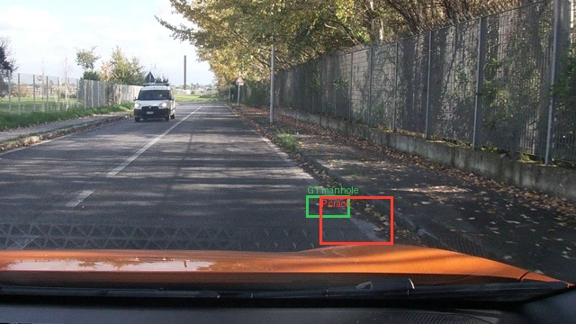
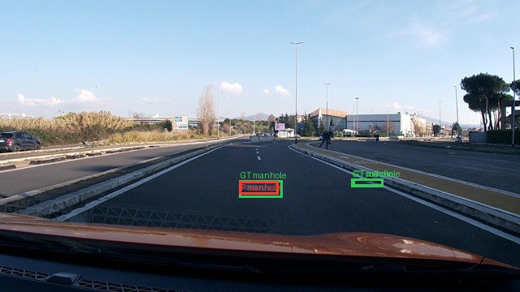
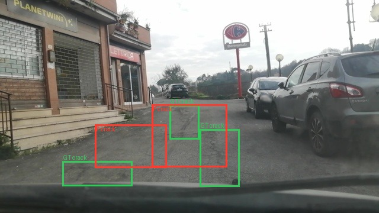
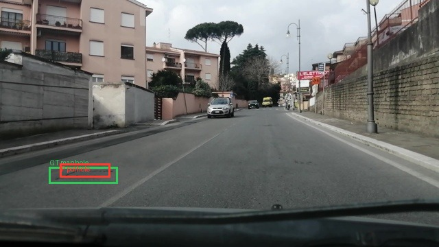
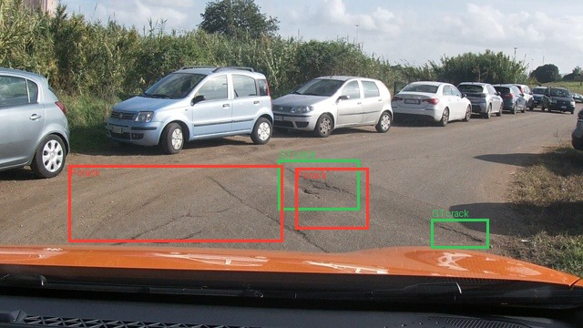
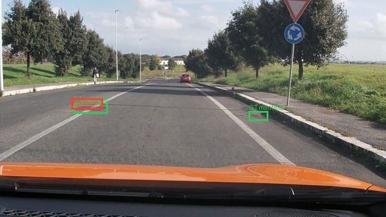

Họ tên: Phạm Thị Ngọc Anh
`dataset_version`: `d10-21e4070301`

## Bảng tổng hợp (từ `report/evidence/*.json`)

| Mã | Setup | Tham số huấn luyện | VRAM đỉnh (GB) | Phút | F1 | CI95 | FP/ảnh | F1 pothole | F1 crack | F1 manhole |
|---|---|---:|---:|---:|---:|---|---:|---:|---:|---:|
| E0 | zero-shot | — | — | — | 0.0849 | [0.0601, 0.1125] | 0.9550 | 0.1447 | 0.0268 | 0.1714 |
| E1 | LoRA LLM | 33,030,144 | 5.82 | 43.32 | 0.2623 | [0.2257, 0.3022] | 1.2572 | 0.1932 | 0.1843 | 0.5238 |
| E2 | + projector | 87,609,344 | 6.30 | 42.75 | 0.0798 | [0.0571, 0.1060] | 1.4534 | 0.0993 | 0.0333 | 0.2222 |
| E3 | + LoRA ViT | 93,900,800 | 6.24 | 52.41 | 0.0019 | [0.0000, 0.0060] | 1.4309 | 0.0000 | 0.0027 | 0.0000 |
| E4a | E1 + data_size=0.1 | 33,030,144 | 6.61 | 43.45 | 0.1669 | [0.1394, 0.1947] | 2.2219 | 0.1524 | 0.0902 | 0.4043 |
| E4b | E1 + data_size=1.0 | 33,030,144 | 5.82 | 43.32 | 0.2623 | [0.2257, 0.3022] | 1.2572 | 0.1932 | 0.1843 | 0.5238 |

## 10 câu hỏi

### Câu 1 — Kiến trúc

Qwen3-VL-4B có ViT khoảng 415M tham số, projector/deep-stack merger khoảng
109M và lõi LLM khoảng 4.0B. E1 chỉ cập nhật LoRA ở 252 module của LLM. E2
giữ phần LoRA đó và mở toàn bộ projector. E3 thêm LoRA ở 96 module ViT (348
module LoRA tổng cộng) bên cạnh projector. Số tham số thực sự được optimizer
cập nhật lần lượt là 33,030,144,
87,609,344 và
93,900,800.

### Câu 2 — E0

`parse_valid_rate` của E0 là 0.8650. Hai lỗi nổi bật là
định vị sai/kích thước box quá lớn và nhầm lớp (đặc biệt crack). Ví dụ output
thô: `vlcsnap-00200: [{"label": "manhole", "bbox_2d": [759, 640, 843, 690]}, {"label": "manhole", "bbox_2d": [910, 786, 998, 827]}]`. E0 chỉ đạt F1=0.0849.

### Câu 3 — Thang 0–1000

Khi cố ý chấm chính output E1 theo pixel, F1 còn 0.0000 (đúng thang: 0.2623). Sai thang làm scorer co giãn lần nữa theo 640×360, khiến box lệch vị trí và
kích thước nên IoU thường không vượt 0.5. Tôi kiểm chứng bằng cách giữ nguyên
prediction E1, chỉ đổi `--coord norm1000` thành `--coord pixel`; bằng chứng nằm
ở `report/evidence/coord_mismatch_e1.json`.

### Câu 4 — Mask loss

Loss chỉ giữ token câu trả lời assistant; token ảnh, prompt và padding đều là
`-100`. Kiểm tra notebook cho đúng 220 visual token và decode phần không mask ra
JSON kết thúc bằng `<|im_end|>`. Nếu tính loss trên toàn chuỗi, phần lớn gradient
bị dùng để học lại ảnh/prompt thay vì cú pháp JSON, nhãn và toạ độ cần sinh.

### Câu 5 — Lượng tử hoá và projector

Tôi dùng NF4 cho LLM nhưng đặt `llm_int8_skip_modules=["visual", "lm_head"]`.
Nhờ đó projector không bị khoá trong trọng số 4-bit và E2/E3 có thể cập nhật
đầy đủ. Các tham số `visual.merger` và `visual.deepstack_merger_list` được ép
sang float32 trước khi bật gradient để tích luỹ ổn định; nếu giữ fp16, chuỗi
deep-stack dễ underflow/overflow. Projector được lưu riêng trong `projector.pt`
và được nạp lại khi suy luận.

### Câu 6 — Split theo phiên quay

Chia ngẫu nhiên sẽ đưa các frame gần như trùng nhau của cùng phiên vào cả train
và test, làm model nhớ bối cảnh và tạo F1 cao giả. Split tất định theo session
không có session giao nhau: train 1.422 ảnh (1.074 pothole, 1.750 crack, 691
manhole), val 276 ảnh (66, 470, 103), test 311 ảnh (121, 299, 163).

### Câu 7 — So sánh E1/E2/E3

E1 F1=0.2623, CI95=[0.2257, 0.3022], VRAM=5.82 GB, thời gian=43.32 phút;
E2 F1=0.0798, CI95=[0.0571, 0.1060], VRAM=6.30 GB, thời gian=42.75 phút;
E3 F1=0.0019, CI95=[0.0000, 0.0060], VRAM=6.24 GB, thời gian=52.41 phút.
E1 là setup tốt nhất và CI95 của nó không giao với E2/E3. Trong lần chạy này,
mở toàn bộ projector không cải thiện so với E1; thêm LoRA ViT còn làm grounding
sụp giảm dù đầu ra E3 vẫn parse hợp lệ ở tỷ lệ 0.9936. Vì vậy E1 vừa chính xác
hơn, vừa dùng ít tham số huấn luyện hơn; E3 còn tốn nhiều thời gian nhất.

### Câu 8 — Khoảng tin cậy

Độ rộng CI95 bootstrap là E0=0.0524, E1=0.0764, E2=0.0489, E3=0.0060.
CI của E0 và E2 giao nhau nhiều nên chưa thể nói E2 khác E0 một cách rõ ràng.
Ngược lại, CI của E1 không giao với E0, E2 hoặc E3, nên dữ liệu bootstrap trên
split này ủng hộ E1 rõ ràng. Tuy vậy, test chỉ có 311 ảnh từ số phiên hữu hạn;
vẫn cần đánh giá trên các phiên quay mới trước khi khái quát hóa kết luận.

### Câu 9 — Phân tích lỗi theo lớp

Ở setup tốt nhất E1, lớp kém nhất là **crack** với
F1=0.1843; các lớp còn lại: pothole=0.1932,
crack=0.1843, manhole=0.5238. Crack thường
mảnh, dài và có biên mơ hồ; pothole nhỏ dễ lẫn với bóng/texture; manhole có hình
học đều hơn. Các ảnh dưới đây dùng box xanh cho GT và box đỏ cho prediction.

### Câu 10 — E4

Tôi chỉ đổi `data_size`: 10% = 142 ảnh so với 100% = 1.422 ảnh, giữ nguyên
setup E1, rank 16, LR 2e-4, batch hiệu dụng 8, 300 bước và seed 42. F1 lần
lượt là 0.1669 (CI95 [0.1394, 0.1947]) và
0.2623 (CI95 [0.2257, 0.3022]). Hai CI95
không giao nhau; kết quả ủng hộ lợi ích rõ ràng của việc dùng toàn bộ dữ liệu
trên split này, dù vẫn cần kiểm chứng trên các phiên quay độc lập khác.

## Nhìn lại

E0 đôi khi sinh JSON hợp lệ nhưng box/lớp sai, cho thấy `parse_valid_rate` cao
không đồng nghĩa với grounding tốt. Khi chạy, Transformers cũng cảnh báo về
kwargs của processor nhưng inference vẫn hoàn tất đủ 311 ảnh. Điểm dễ bỏ sót
nhất là PEFT không tự lưu projector đã mở; thiếu `projector.pt` sẽ làm E2/E3
quay về projector gốc khi suy luận.
