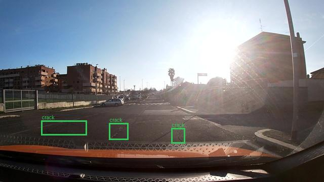
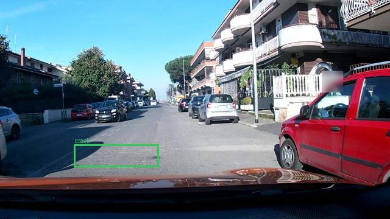
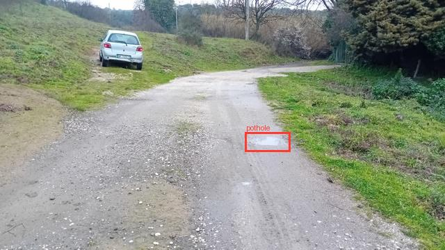
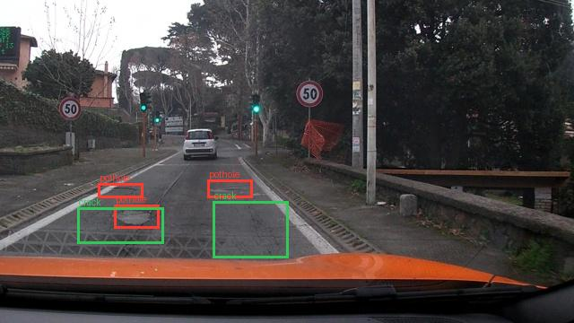
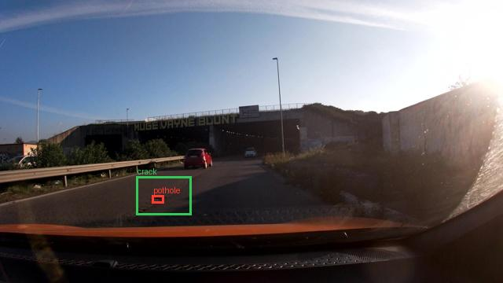
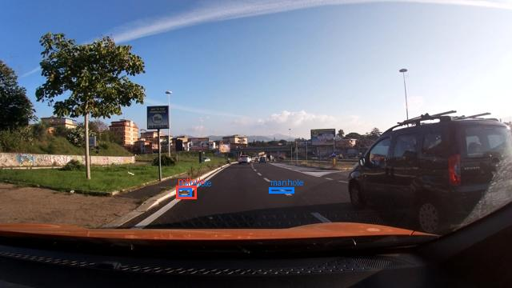

Họ tên: Phạm Thị Ngọc Anh
`dataset_version`: `d10-21e4070301`

> Trạng thái: E0 và E1 dưới đây được lấy từ output thật đã lưu trong
> `lab_day10.ipynb`. E2, E3 và E4 chưa có kết quả trong notebook hiện tại.
> Cell cuối của notebook sẽ chạy các phần còn thiếu và tự ghi lại toàn bộ báo
> cáo này từ `report/evidence/*.json`; không dùng số liệu mẫu.

## Bảng tổng hợp

| Mã | Setup | Tham số huấn luyện | VRAM đỉnh (GB) | Phút | F1 | CI95 | FP/ảnh | F1 pothole | F1 crack | F1 manhole |
|---|---|---:|---:|---:|---:|---|---:|---:|---:|---:|
| E0 | zero-shot | 0 | — | — | 0.0849 | [0.0601, 0.1125] | 0.9550 | 0.1447 | 0.0268 | 0.1714 |
| E1 | LoRA LLM | 33,030,144 | 4.77 | 43.89 | 0.2757 | [0.2394, 0.3150] | 1.2219 | 0.2136 | 0.1964 | 0.5382 |
| E2 | + projector | Chưa chạy | Chưa chạy | Chưa chạy | Chưa chạy | Chưa chạy | Chưa chạy | Chưa chạy | Chưa chạy | Chưa chạy |
| E3 | + LoRA ViT | Chưa chạy | Chưa chạy | Chưa chạy | Chưa chạy | Chưa chạy | Chưa chạy | Chưa chạy | Chưa chạy | Chưa chạy |
| E4 | `data_size`: 0.1 và 1.0 | Chưa chạy | Chưa chạy | Chưa chạy | Chưa chạy | Chưa chạy | Chưa chạy | Chưa chạy | Chưa chạy | Chưa chạy |

## Kết quả đã kiểm chứng

- Split tất định: train/val/test = 1.422/276/311 ảnh; không có session giao nhau.
- Box train: 1.074 pothole, 1.750 crack, 691 manhole.
- Box val: 66 pothole, 470 crack, 103 manhole.
- Box test: 121 pothole, 299 crack, 163 manhole.
- Một ảnh 640×360 tạo đúng 220 visual token.
- Decode phần `labels != -100` là JSON assistant và kết thúc bằng `<|im_end|>`.
- E0 có `parse_valid_rate = 0.865`; E1 có `parse_valid_rate = 0.994`.
- F1(E1) − F1(E0) = 0.1909, vượt yêu cầu 0.10.
- Reward E5 đạt đủ năm ca: 1.0, 0.0, 0.2, 0.6, 1.0.

## 10 câu hỏi

Các câu trả lời hoàn chỉnh phụ thuộc vào số thật của E2/E3/E4. Hàm
`finish_kaggle.write_report()` sẽ tự tạo phần trả lời bằng số liệu evidence sau
khi cell cuối notebook chạy xong. Không kết luận setup tốt nhất hoặc độ chồng
lấn CI trước khi ba thí nghiệm còn thiếu hoàn tất.

## Ảnh ground truth đã khôi phục từ output notebook

Sáu ảnh dưới đây là ảnh ground truth thật được trích từ output notebook. Cell
cuối sẽ bổ sung sáu ảnh so sánh GT (xanh) và prediction (đỏ) của setup tốt nhất.

